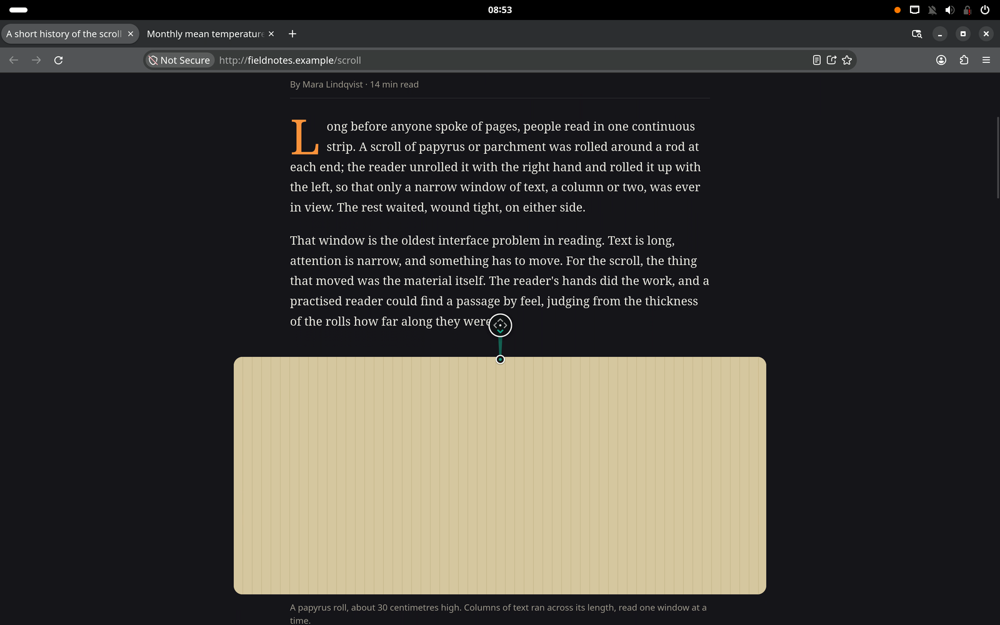
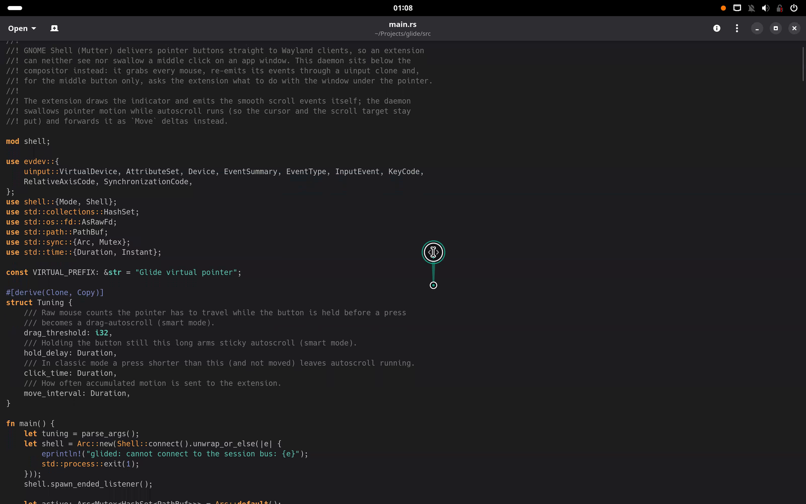
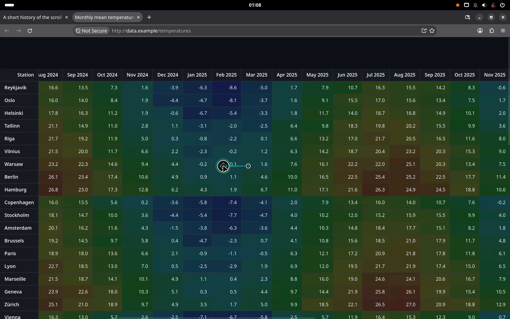
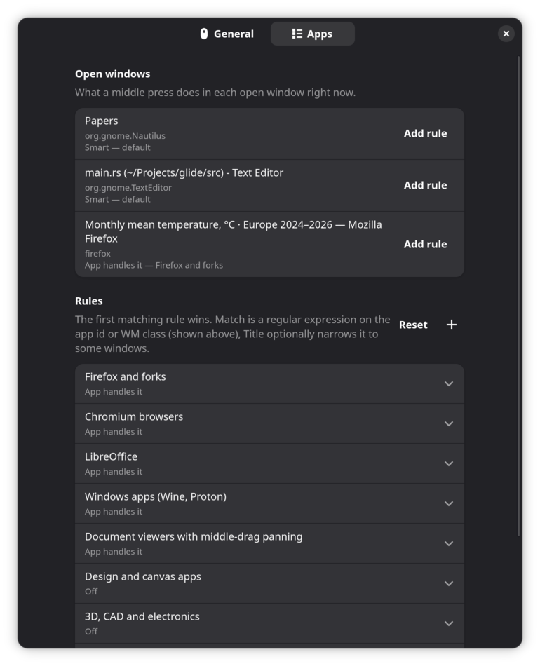

# Glide

Middle-click autoscroll for GNOME, like on Windows: press the middle mouse button, move the mouse up or down, and the page scrolls by itself, faster the further you move. A plain middle click stays a middle click, and apps where middle drag means something else (Figma, Blender, CAD, games, remote desktops) are left alone.


[Website](https://taulit.github.io/glide/) · [Full-quality video](https://taulit.github.io/glide/media/glide-demo.mp4) · [Install](#install)

| Hold and drag | Click to scroll | Sideways and diagonal | Per-app rules |
| :---: | :---: | :---: | :---: |
|  |  |  |  |

The browser scenes show Glide's indicator as it looks with the browser rule set to Smart. By default Glide hands browsers their own autoscroll (see [Browsers](#browsers)).

## Why

On Windows a middle press in almost any scrollable view starts autoscroll. On Linux there is none: GNOME has no such feature, Firefox ships it switched off, and Chromium only behind a flag. Glide adds it to the whole desktop, with the rules that make it bearable: what a middle press does depends on the app under the pointer.

## How it works

| You do                                          | Smart mode (default)                                                      | Classic mode (Windows)                               |
| ----------------------------------------------- | ------------------------------------------------------------------------- | ---------------------------------------------------- |
| Click the middle button                         | A normal middle click: open link in new tab, close tab, paste the selection | Starts autoscroll, which runs until the next click   |
| Hold the button and move the mouse              | Scrolls while held, stops when you let go                                 | The same                                             |
| Press, pause a moment, release                  | The anchor appears and keeps scrolling until you click                    | The same                                             |
| Esc, any click, or turning the wheel            | Stops autoscroll (the click is consumed, like on Windows)                 | The same                                             |

While autoscroll runs the cursor turns into the indicator and stays where you pressed, so the view under it keeps scrolling, and a small puck on a rubber band shows where your hand is: the further you pull, the faster it scrolls. The puck moves with your usual pointer speed, can be pulled past the edge of the screen (then the band keeps growing), and when autoscroll ends the cursor comes back where the puck is. Near the anchor is a dead zone that does not scroll. Up, down, left and right work; diagonals too.

The indicator follows the look of current Linux cursors (dark body, white rim, soft shadow) and takes the accent colour of the system. In click-to-scroll mode it gets an accent ring, so you can tell it keeps going without the button.

## When Glide steps in, and when not

The first rule that matches the window under the pointer wins. Rules match the app id or WM class with a regular expression, and optionally the window title. The built-in list:

| Apps                                                                                         | Mode            | Why                                                                                                       |
| -------------------------------------------------------------------------------------------- | --------------- | --------------------------------------------------------------------------------------------------------- |
| Canvas web apps in a browser, by window title (Figma, FigJam, Excalidraw, tldraw, Miro, Penpot, draw.io, Google Maps, Photopea, Canva, …) | App handles it | Middle drag pans the canvas; this holds even when the browser rule is Smart |
| Firefox and forks (LibreWolf, Zen, Floorp, Waterfox, Tor Browser, Mullvad Browser)           | App handles it  | The browser knows whether you are over a link, a text field or a canvas like Figma or Google Maps          |
| Chrome, Chromium, Brave, Vivaldi, Edge, Opera, Thorium, Helium                               | App handles it  | Same as Firefox, with `--enable-blink-features=MiddleClickAutoscroll`                                     |
| LibreOffice                                                                                  | App handles it  | Has its own autoscroll                                                                                    |
| Windows apps in Wine or Proton (`*.exe`)                                                     | App handles it  | They bring their own Windows behaviour                                                                    |
| Evince, Papers, Okular, Zathura                                                              | App handles it  | Middle drag pans the page                                                                                 |
| Figma, GIMP, Inkscape, Krita, Penpot, darktable, draw.io, Excalidraw, Xournal++, Rnote, OBS, Kdenlive, Shotcut, DaVinci Resolve | Off | Middle drag pans the canvas or the timeline |
| Blender, FreeCAD, KiCad, OpenSCAD, PrusaSlicer, OrcaSlicer, Bambu Studio, Cura, Godot, Unity, Unreal | Off     | Middle drag orbits or pans the 3D view                                                                    |
| VS Code, VSCodium, Cursor, Windsurf                                                          | Off             | Middle drag makes a box selection                                                                         |
| virt-manager, Boxes, Remmina, Connections, VNC, FreeRDP, Moonlight, Parsec, RustDesk, AnyDesk, TeamViewer, QEMU, VirtualBox, Looking Glass | Off | The middle button belongs to the remote machine |
| Steam games, gamescope, Minecraft, RetroArch, Dolphin, PCSX2, RPCS3, Ryujinx, osu!, Factorio | Off             | Games bind the middle button                                                                              |
| Fullscreen windows                                                                           | Off             | Games and video players (a switch in the settings)                                                        |
| The overview, menus and dialogs of the shell                                                 | Off             | Shell UI keeps its own middle click                                                                       |
| Everything else (Files, Settings, Text Editor, terminals, GTK and Qt apps, Electron apps)    | Smart           | The default, can be changed to Classic or Off                                                             |

On the Apps page of the settings every open window is listed with what a middle press does there right now and why, and one click turns it into a rule.

## Install

> Glide is new (0.1). The extension, the rules and the scrolling are tested in a sandboxed GNOME Shell 51, the daemon is built and linted in CI. Reports from real mice and setups are very welcome in the [issues](https://github.com/taulit/glide/issues).

Requirements: GNOME Shell 49, 50 or 51 on Wayland, Rust (cargo), Node 24 or newer with pnpm, and read access to the mice plus write access to `/dev/uinput`.

```sh
git clone https://github.com/taulit/glide && cd glide
./install.sh            # daemon + extension
./install.sh --browsers # also switches on the browsers' own autoscroll
```

The installer builds the daemon and the extension, installs the daemon as the systemd user service `glided`, copies the extension and enables it. It checks the permissions first and prints what is missing. Usually that is:

```sh
sudo usermod -aG input $USER
echo 'KERNEL=="uinput", GROUP="input", MODE="0660", TAG+="uaccess"' | sudo tee /etc/udev/rules.d/60-glide-uinput.rules
```

Then log out and in again. The settings are in the Extensions app or with `gnome-extensions prefs glide@taulit.github.io`.

### Browsers

Browsers do autoscroll better than any outside tool, because only they know what is under the pointer. Glide therefore lets them do it, and `--browsers` switches it on:

- Firefox: `general.autoScroll = true` in the `user.js` of each profile.
- Chrome, Chromium, Brave: `--enable-blink-features=MiddleClickAutoscroll` in `~/.config/<browser>-flags.conf`.

If you would rather have Glide's indicator in the browser too, set the browser rule to Smart or Classic. Canvas web apps such as Figma stay with the browser either way: a rule above the browser rules matches them by window title.

## Settings

| Setting                          | Default | What it does                                              |
| -------------------------------- | ------- | --------------------------------------------------------- |
| Autoscroll                       | on      | Switches Glide off without uninstalling it                |
| Everywhere else                  | Smart   | The mode for apps without a rule: Smart, Classic or Off   |
| Leave fullscreen windows alone   | on      | No autoscroll in fullscreen windows unless a rule says so |
| Speed                            | 1.0     | How fast a given distance scrolls                         |
| Sensitivity                      | 1.0     | How far the puck moves per mouse movement                 |
| Dead zone                        | 14 px   | Distance around the anchor that does not scroll           |

The daemon takes `--drag-threshold COUNTS` (12), `--hold-delay-ms MS` (280) and `--click-ms MS` (250); add them to `ExecStart` with `systemctl --user edit glided`.

## Architecture

GNOME Shell hands mouse buttons straight to Wayland apps, so an extension alone can neither see nor hold back a middle click on an app window. Glide therefore has two halves:

- **`glided`** (Rust, `daemon/`) sits below the compositor. It grabs each mouse through evdev and passes every event on through a uinput clone, unchanged, except the middle button. On a middle press it asks the extension over D-Bus what to do. If the extension does not answer within 150 ms, the click passes through.
- **The extension** (TypeScript for GJS, `extension/`) finds the window under the pointer, applies the rules, draws the indicator and sends smooth scroll events through a Clutter virtual pointer, so apps get the same pixel-precise scrolling as from a touchpad. While autoscroll runs it boxes the cursor in at the anchor with four pointer barriers: the mouse motion still goes through libinput, so the puck moves with your usual pointer speed and acceleration, and Mutter reports each push against a wall. GTK 4 apps scroll a smooth-scroll step about five times shorter than Chromium, Firefox or GTK 3, so Glide scales the scroll up for them.

Touchpads and tablets are not grabbed.

## Uninstall

```sh
systemctl --user disable --now glided
rm ~/.local/bin/glided ~/.config/systemd/user/glided.service
gnome-extensions uninstall glide@taulit.github.io
```

## Ideas

Things that would fit the same gesture, not built yet:

- Middle drag over the top bar or an empty desktop edge to switch workspaces.
- Middle click on a window title bar to minimise or send it to the back (Mutter already has a setting for that).
- A speed curve preview in the settings.

## Development

| Path | What |
| --- | --- |
| `daemon/` | `glided`, Rust: `cargo build --release`, `cargo clippy` |
| `extension/` | The GNOME Shell extension, TypeScript: `pnpm install && pnpm build` (into `build/`), `pnpm lint`, `pnpm typecheck` |
| `site/` | The website ([taulit.github.io/glide](https://taulit.github.io/glide/)), Astro: `pnpm install && pnpm dev` |
| `docs/` | Screenshots and the demo used in this file |

The extension exports `io.github.taulit.Glide` on the session bus at `/io/github/taulit/Glide` (`Query`, `Begin`, `Move`, `Stick`, `End`, `Describe`), which is what the daemon calls. The demo and screenshots were recorded by driving that interface in a headless GNOME Shell.

## License

GPL-2.0-or-later, see [LICENSE](LICENSE).
